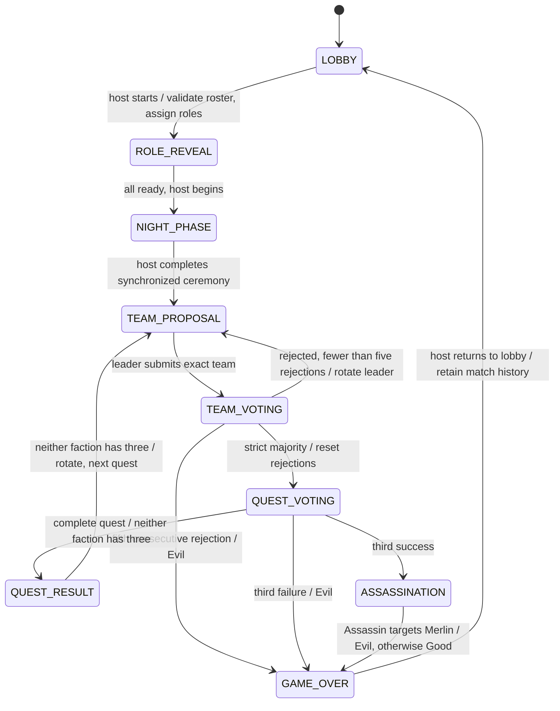

# Crownfall architecture and implementation plan

## Milestone boundaries

1. Foundation: React/TypeScript/Vite, Tailwind theme, reusable controls, original SVG crown, locally bundled fonts, home, host/join, tutorial and preferences.
2. Lobby: anonymous identity, transactional create/join/leave/remove/settings RPCs, member-only reads, invitation links, QR generation/scanning, room-row Realtime invalidation and reconnection refetch. Live verification needs a configured Supabase project. Automatic host recovery and cleanup scheduling remain pending.
3. Roles/night: implemented cryptographic backend assignment, authorized private information, ready confirmations, synchronized steps and host narration controls. Hosted verification remains pending.
4. Gameplay: implemented proposals, private votes/submissions, aggregate resolution, scoreboard, assassination, victory and role reveal. Hosted concurrency verification is pending.
5. Reliability: abandonment, full-game return to lobby and new match IDs are implemented. Host lease/recovery, cleanup and physical mobile lifecycle testing remain pending.
6. Release: run database security/concurrency tests and multi-browser real multiplayer E2E; deploy to Cloudflare Pages and test multiple phones.

This revision implements the foundation, lobby, roles/night and core gameplay milestones, including fresh matches using the same group. Automatic host recovery, cleanup and live platform/device validation remain pending.

## Quest gameplay implementation

`play_action` authorizes the caller through `auth.uid()`, immutable match membership, the current match identity and phase. It locks room then game, validates expected version and inputs, and resolves the final ballot/submission exactly once within the same transaction. A completed or retired match cannot mutate a newer match in the same room.

The backend `private.quest_rules` table is authoritative for team sizes. Leaders propose exactly the required number of distinct match players. Everyone votes once; a strict majority approves and resets consecutive rejections. Ties reject; rejection five ends the match for Evil. Leaders rotate by snapshot seating order after rejection and when the host opens the next quest.

Approved quest members alone submit. The function checks faction before permitting Fail. Public state reveals an aggregate submission count and the caller's own submitted flag, never other submitters or individual choices. Only complete quests expose aggregate Fail totals/results. Quest four with seven or more players needs two Fail submissions. Three failures end for Evil; three successes enter assassination without revealing Merlin. The Assassin alone may commit one validated final target; all roles become visible only after resolution.

`get_game` provides safe shared state plus the caller's own team ballot and quest-submitted flag. Individual approval votes appear in completed proposal history only after all players vote. Quest choices remain private even after game over. Events use explicit allowlisted aggregate payloads. Realtime still publishes only room invalidations, not game tables, votes or submissions.

For simultaneous ballots, the client retries only database error `40001` (an explicitly rejected stale version), at most four attempts, against the same match/proposal/quest and only if its own submission is still absent. Network errors, changed phases and already-sealed choices are never resubmitted automatically. Other stale actions require a manual retry after refetch. Actual parallel Supabase-session testing is still a release gate.

Completed matches remain readable while the room is `PLAYING`. Host return to lobby clears the current view without deleting history. A monotonic match number selects the latest match independently of timestamp ties. Starting again preserves nicknames/membership and generates a new match/roles. Game-over actions are locked except the authorized return to lobby.

## Roles and night implementation

`start_game` locks the room, validates authenticated host, expected version, roster and role configuration, then snapshots participants, assigns shuffled roles and picks an initial leader in one transaction. Rejection-sampled pgcrypto bytes power Fisher–Yates and leader selection without modulo bias. Every match has a new ID and immutable role configuration.

`get_game` returns an allowlisted snapshot; all-role reveal is populated only at `GAME_OVER`. `get_my_role` separately computes only the caller’s own character and allowed knowledge. It accepts a game ID, never a target player ID. Merlin sees Evil except Mordred (including Oberon); non-Oberon Evil sees non-Oberon teammates; Oberon sees nobody; Percival sees Merlin/Morgana candidates. Completed/abandoned roles cannot be retrieved through this private endpoint. No secret assignments enter Realtime.

`game_action` locks the room before the game row to maintain a consistent lock order, validates authenticated match membership, phase, host permissions, duplicate confirmations and expected version, then bumps game and room versions. `rooms.version` is the only Realtime invalidation signal. The game hook refetches on subscription/focus/visibility/network restoration and every ten seconds, rejecting older snapshots.

The private card fetches only after a tap. Hiding, blurring, unmounting and confirmation clear its in-memory character; late responses cannot reopen it. No secret is written to browser storage. The local demo still cannot assign roles, and partial cloud configuration fails explicitly.

The backend generates public ceremony captions from selected roles. Only the host can enable local speech. Enabled narration follows synchronized steps; replay/mute/voice settings remain local. Pause/resume and Next require backend authorization. Speech completion never advances a step. Returning from a hidden tab requires explicit audio activation again. Device speech restrictions may require replay; text and manual progression remain available.

Host abandonment changes the phase to `ABANDONED`, records completion without a winner, restores `LOBBY`, and preserves private history. A subsequent start uses fresh roles and a new match ID. Completed matches instead offer the host Play Again / Return to Lobby.

## Components and data flow

React Router owns routes; `src/services/rooms.ts` and `src/services/game.ts` form the Supabase boundary. Anonymous sessions are restored before RPCs. Actions derive the actor from `auth.uid()`, never a submitted user ID. Host permissions cover the lobby and ceremony without extra secret access.

For lobby changes, `rooms.version` increments in the same transaction as a membership or settings mutation. Clients subscribe only to this sanitized room row, then fetch an authorized snapshot. Focus, network restoration, subscription recovery and a 15-second fallback poll refetch state. Presence is not used for authority or eviction. The UI’s connection badge reports subscription state, not proof that every other device is online.

When both environment variables are absent, a clearly labeled local demo uses browser storage for room data. Partial configuration fails explicitly. Production anonymous sessions persist through the Supabase SDK. Production role assignments remain private in the database; a revealed own character lives only in memory. Sample participants cannot start a match.

## Authoritative game state machine

All core transitions below are implemented. Hosts may also abandon an unfinished match, returning to the lobby without a winner or role reveal.

Game RPCs lock room then game (`FOR UPDATE`), compare expected version, validate actor/membership/phase/duplicates, and increment versions once per committed action. Rejected operations roll back. Returning a completed match to lobby changes only the room version. Parallel-session race tests remain required.

Merlin and Assassin are mandatory. Merlin knows Evil except Mordred (including Oberon). Evil teammates see one another except Oberon; Oberon sees no teammates. Percival sees Merlin/Morgana candidates without identifying which is which. `get_my_role` computes permitted knowledge on the server; it never returns assignments for client-side filtering.

## Database and security model

`public.rooms` and `public.room_players` are the only client-readable tables. RLS grants read access only to seated authenticated users. There are no client write grants. Room codes are generated with database cryptographic randomness over a 32-character alphabet, retried on unique collision. Anonymous sessions are the authenticated database role, distinct from the unauthenticated `anon` role.

`private.is_member` avoids recursive room-player RLS. It uses `auth.uid()`, a fixed empty search path and a boolean result. The private schema is not an exposed API schema. RPC functions use schema-qualified references, revoke default public execution and grant execution only to authenticated sessions.

`create_room` limits each identity to ten rooms per hour; Supabase anonymous-auth abuse controls/CAPTCHA are also required for an Internet release. Per-IP join throttling is not implemented. Codes are invitations rather than passwords. Avoid publishing codes for private groups.

`games`, `team_proposals`, `quest_results`, `game_events` have RLS enabled and no direct client grants. `private.game_players`, `game_roles`, `team_votes`, `quest_submissions` remain private, RLS enabled and directly inaccessible to clients. Authenticated RPCs return only authorized snapshots or own-character information. No secret tables enter Realtime. Match players snapshot identities and nicknames for durable history. Start transactions create game and snapshot rows together using the deferred leader foreign key.

Public events use explicit payloads. Quest progress exposes an aggregate count, never other submitter identities/order or raw choices. Individual approval votes become public only after every player votes. Assassination resolves before any all-role reveal.

## Recovery and lifecycle

Refresh restores the browser’s anonymous auth session, then authorized room state. Rejoining the same room under that identity is idempotent. Brief disconnects never evict participants. Explicit host departure transfers hosting to the earliest remaining seat under the room lock. A disconnected host retains ownership and can reconnect; automatic takeover is intentionally not implemented until a server-clock lease and recovery policy are tested. There is no account recovery if a user clears their browser authentication storage.

Rooms expire after 24 hours. Lobby RPCs refuse new actions/reads after expiry. Active-match RPCs remain available so players can complete the ceremony or abandon it safely; the direct `/game/:code` route continues to work. Physical cleanup is not installed. Future cleanup must retain game history and avoid foreign-key conflicts; do not simply delete rooms with matches.
