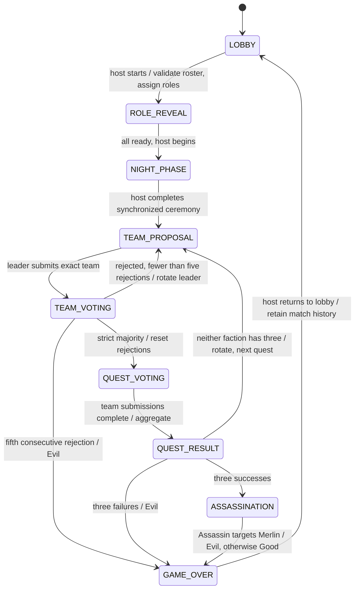

# Crownfall architecture and implementation plan

## Milestone boundaries

1. Foundation: React/TypeScript/Vite, Tailwind theme, reusable controls, original SVG crown, locally bundled fonts, home, host/join, tutorial and preferences.
2. Lobby: anonymous identity, transactional create/join/leave/remove/settings RPCs, member-only reads, invitation links, QR generation/scanning, room-row Realtime invalidation and reconnection refetch. Live verification needs a configured Supabase project. Automatic host recovery and cleanup scheduling remain pending.
3. Roles/night: implement cryptographically shuffled backend assignment, authorized private information, ready confirmations, synchronized night steps and host narration controls.
4. Gameplay: implement transactional proposals, private votes, private quest submissions, aggregate resolution, assassination and role reveal.
5. Reliability: new match IDs for rematches, host lease/recovery, abandonment, cleanup and mobile lifecycle testing.
6. Release: run database security/concurrency tests and multi-browser real multiplayer E2E; deploy to Cloudflare Pages and test multiple phones.

This revision implements milestone 1 and the lobby portion of milestone 2. It prepares storage for later phases. It does not implement role assignment or gameplay RPCs.

## Components and data flow

React Router owns routes; `src/services/rooms.ts` is the boundary between UI and Supabase. The service restores an anonymous authenticated session before RPCs. Database actions always derive the actor from `auth.uid()`, never a submitted user ID. The host is a player with extra lobby permissions, with no secret-reading privileges.

For lobby changes, `rooms.version` increments in the same transaction as a membership or settings mutation. Clients subscribe only to this sanitized room row, then fetch an authorized snapshot. Focus, network restoration, subscription recovery and a 15-second fallback poll refetch state. Presence is not used for authority or eviction. The UI’s connection badge reports subscription state, not proof that every other device is online.

Without both environment variables, a separate, clearly labeled local demo uses browser storage. Only the demo stores room data locally. Production anonymous session persistence is managed by the Supabase SDK. No role data is stored by this milestone. Sample participants are manually added and never presented as real multiplayer.

## Authoritative game state machine (planned)

Each future game RPC must lock the game row (`FOR UPDATE`), compare expected version, validate actor, immutable match membership, phase, exact inputs and duplicate constraints, and increment version exactly once per committed action. Room locking serializes lobby capacity and host changes. Rejected client operations must roll back completely.

Merlin and Assassin are mandatory. Merlin knows Evil except Mordred (including Oberon). Evil teammates see one another except Oberon; Oberon sees no teammates. Percival sees Merlin/Morgana candidates without identifying which is which. The future private-info RPC must compute only the caller’s permitted information, and must not return assignments for client-side filtering.

## Database and security model

`public.rooms` and `public.room_players` are the only client-readable tables. RLS grants read access only to seated authenticated users. There are no client write grants. Room codes are generated with database cryptographic randomness over a 32-character alphabet, retried on unique collision. Anonymous sessions are the authenticated database role, distinct from the unauthenticated `anon` role.

`private.is_member` avoids recursive room-player RLS. It uses `auth.uid()`, a fixed empty search path and a boolean result. The private schema is not an exposed API schema. RPC functions use schema-qualified references, revoke default public execution and grant execution only to authenticated sessions.

`create_room` limits each identity to ten rooms per hour; Supabase anonymous-auth abuse controls/CAPTCHA are also required for an Internet release. Per-IP join throttling is not implemented. Codes are invitations rather than passwords. Avoid publishing codes for private groups.

`games`, `team_proposals`, `quest_results`, `game_events` have RLS enabled and no client grants/policies yet. `private.game_players`, `game_roles`, `team_votes`, `quest_submissions` are private, RLS enabled, and inaccessible to clients. No secret tables are added to Realtime. Match players snapshot identities and nicknames to preserve old match history when lobby membership changes. Start-game transactions must create game and snapshot rows together using the deferred leader foreign key.

Future public events must use an explicit payload allowlist. Quest submission progress must expose at most an aggregate count, never submitter identity/order or raw choices. Individual approval votes become public only after every player votes. Assassination must resolve before any role reveal.

## Recovery and lifecycle

Refresh restores the browser’s anonymous auth session, then authorized room state. Rejoining the same room under that identity is idempotent. Brief disconnects never evict participants. Explicit host departure transfers hosting to the earliest remaining seat under the room lock. A disconnected host retains ownership and can reconnect; automatic takeover is intentionally not implemented until a server-clock lease and recovery policy are tested. There is no account recovery if a user clears their browser authentication storage.

Rooms expire after 24 hours. RPCs refuse new actions or reads after expiry. Physical deletion/anonymization scheduling is not installed. Future cleanup must retain game history as intended and avoid foreign-key conflicts; do not simply delete rooms with matches.
